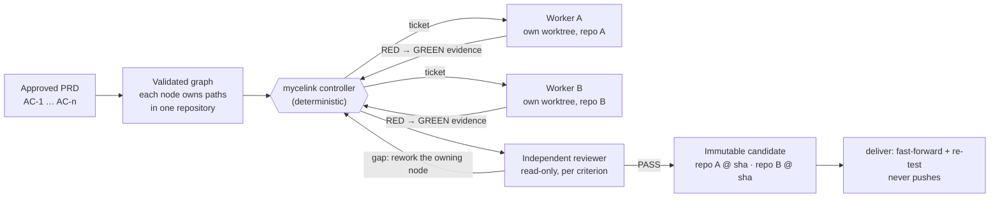

<p align="center"></p>

# Mycelink

**One approved PRD → isolated Claude Code workers in their own Git worktrees →
strict TDD → independent review of every acceptance criterion, with rework →
one immutable candidate that pins the exact commit SHA of every repository.**

[](https://github.com/nigunpark/mycelink/actions/workflows/ci.yml)
[](LICENSE)


Mycelink is a Claude Code plugin plus a deterministic controller (`mycelink`)
for features that span **several Git repositories**. Claude does the
judgement work: it decomposes, implements and reviews. The controller does
the bookkeeping a model cannot be trusted with: what may run next, which
paths a worker may touch, whether a RED really failed, and which exact
commits make up the result.

**It is deterministic orchestration, not a smarter model and not a generic
agent launcher.** It does not improve what Claude writes. It makes each step
checkable and refuses to advance on a model's say-so.

```bash
claude plugin marketplace add nigunpark/mycelink
claude plugin install mycelink@mycelink-marketplace
```

Then, inside Claude Code: `/mycelink:run FEAT-101`.
New here? The [five-minute quickstart](#quickstart) walks through a two-repository demo.

<p align="center"><a href="https://github.com/nigunpark/mycelink/blob/main/examples/quickstart/SAMPLE-OUTPUT.md"><picture><source media="(prefers-reduced-motion: reduce)" srcset="https://github.com/nigunpark/mycelink/blob/main/docs/assets/quickstart-demo-static.png?raw=true"></picture></a></p>

<sub>**Scripted walkthrough, no model** (about a minute, looping): the real controller, Git and gates
on the [quickstart](#quickstart)'s two repositories, with a scripted worker and reviewer and an
AC-4 review gap planted on purpose. Its output is
[SAMPLE-OUTPUT.md](https://github.com/nigunpark/mycelink/blob/main/examples/quickstart/SAMPLE-OUTPUT.md).
A real Claude Code run of the same demo, with its own SHAs, is
[reported separately](https://github.com/nigunpark/mycelink/blob/main/docs/evals/2026-10-15-public-two-repo-demo.md).</sub>

> **Status: public beta (`0.3.0-beta.2`).** Interfaces may change before 1.0.
> Mycelink is an independent, third-party project. It is **not affiliated with
> or endorsed by Anthropic**. Licensed under [Apache-2.0](LICENSE). No telemetry.

The separate [Codex plugin](docs/CODEX.md) has an **experimental, explicitly
opted-in disposable-repository** worker/review/delivery path. It is not Claude
host parity, a hardened hostile-worker sandbox or a production-readiness claim.

---

## How it works



1. **Plan.** `/mycelink:prd` and `/mycelink:plan` turn a requirement into a
   PRD with stable `AC-n` criteria and a validated graph. Each node belongs to
   one repository and owns explicit paths.
2. **Run.** The controller hands out one node at a time, and only when its
   dependencies are done and no running node owns the same paths. Each worker
   gets its own Git worktree. A worker must show a failing test (RED) that
   fails because the behaviour is missing, then GREEN with the identical
   command. Exit codes are recorded as evidence; a sentence saying "done"
   is not.
3. **Review.** A separate read-only reviewer judges every acceptance
   criterion. A gap reopens only the node that owns that criterion, within a
   per-criterion budget.
4. **Bind and deliver.** One manifest binds the exact SHA of every repository
   and the hashes of the shared contracts. Change any of them and you get a
   new candidate id. `deliver` fast-forwards each base branch to exactly that
   SHA and re-runs its tests. It never pushes.

Conversation history is never the source of truth. The PRD, the graph, the
state file, the event log, recorded command evidence and Git SHAs are.

---

## Quickstart

Five minutes to start, using a demo with two independent Git repositories,
`orders-api` (publishes order-status payloads) and `orders-web` (renders
them), and one approved PRD, ORD-101, that needs both to change together
behind a shared contract. Full walkthrough:
[`examples/quickstart/`](https://github.com/nigunpark/mycelink/tree/main/examples/quickstart).

```bash
# 1. Create the demo workspace: three local Git repositories, no model, no network
git clone https://github.com/nigunpark/mycelink.git
cd mycelink
node examples/quickstart/setup.mjs --out ../mycelink-quickstart

# 2. Optional, no model: check the demo, then watch a scripted run of the whole feature
node examples/quickstart/verify-demo.mjs
node examples/quickstart/walkthrough.mjs

# 3. Run it for real: start Claude Code in the control repository with this clone's plugin
cd ../mycelink-quickstart/control
claude --plugin-dir ../../mycelink
```

Then, inside Claude Code: `/mycelink:run ORD-101`. The API node runs first in
its own worktree, the web node once the API node is DONE, then the
independent review, the candidate and the delivery. At the end,
`control/features/ORD-101/candidates/` holds the manifest that binds both
repositories' exact SHAs, and `main` in each repository is fast-forwarded to
exactly those SHAs. Nothing is pushed. With the plugin already installed,
pass `--mycelink <plugin-install-path>/bin/mycelink.mjs` to `setup.mjs` and
start plain `claude`.

After the clone, steps 1 and 2 start no model and use no network. Step 2's
walkthrough runs the real controller, Git and gates with a scripted worker
and reviewer, including a review gap planted on purpose and its rework.
[Its sample output](https://github.com/nigunpark/mycelink/blob/main/examples/quickstart/SAMPLE-OUTPUT.md)
is a deterministic scripted walkthrough, **not a model run**.

Step 3 runs real Claude sessions (a worker per node, plus a reviewer) and
uses your Claude plan or API credit. The run takes longer than the setup.
One maintainer run of exactly this demo, with Claude Opus 5.5, delivered both
repositories and passed every check afterwards; it took about 17 minutes and
six subagent sessions, and Claude Code reported $5.55 at API list prices.
That is one run, not an average:
[the report](https://github.com/nigunpark/mycelink/blob/main/docs/evals/2026-10-15-public-two-repo-demo.md)
has its SHAs, sessions, recovery and limits.
To use your own repositories, see
[Use it on your own repositories](#use-it-on-your-own-repositories).

---

## How it compares

How the same multi-repository feature is handled. This compares process
guarantees, not the quality of the code a model writes.

| | Several Claude terminals by hand | One session prompted to use subagents | Mycelink |
|---|---|---|---|
| **What runs next** | you decide | the model decides | the controller, from graph dependencies, path ownership and resource capacity |
| **Isolation** | whatever branches and folders you set up | a shared working tree unless you arrange otherwise | one Git worktree and `wip/<feature>/<node>` branch per node; writes outside it are blocked |
| **TDD** | by instruction | by instruction | enforced: a RED must fail for the missing behaviour, GREEN re-runs the identical command, and history is checked test-first at settle |
| **"Done" means** | you looked | the model said so | every declared evidence kind is recorded, and an independent reviewer passed every criterion |
| **Review and rework** | you | often the same session reviewing its own work | a read-only reviewer per criterion; a gap reworks only the node that owns it, within a budget |
| **Multi-repo result** | branches you line up yourself | branches you line up yourself | one immutable manifest of exact SHAs plus contract hashes; `candidate verify` detects drift |
| **After an interruption** | you remember | the conversation context | state file and event log; `/mycelink:run` resumes, and stale workers are fenced off |
| **Overhead** | lowest | low | highest: a control repository, a PRD with criteria, and more sessions per feature |
| **Good for** | quick, small edits | exploration in one repository | features that cross repositories and need a checkable trail |

---

## Evidence

Everything below was run and reported by the Mycelink maintainer
(self-reported, not an independent study), and none of it has a
without-plugin baseline.

### A real run across two independent repositories

> **One maintainer-run demo, not a benchmark.** Full report:
> [`docs/evals/2026-10-15-public-two-repo-demo.md`](https://github.com/nigunpark/mycelink/blob/main/docs/evals/2026-10-15-public-two-repo-demo.md)

| | |
|---|---|
| **What ran** | `/mycelink:run ORD-101` from the [quickstart](#quickstart), in Claude Code 2.1.290 with Claude Opus 5.5, on Windows: two independent Git repositories, `orders-api` and `orders-web`, behind one shared contract |
| **Result** | candidate ORD-101-C001 delivered: `orders-api` at `27bde55218f7`, `orders-web` at `9197a9f4af69`. Checked afterwards: `feature verify --delivered` and `candidate verify` ok, an acceptance probe outside both repositories 4/4 (0/4 on the baselines), 8/8 and 11/11 tests, clean trees, nothing pushed |
| **What happened** | 6 subagent sessions: 3 workers, 3 reviewers. Both nodes settled first time. The first reviewer returned no usable verdict and Mycelink started a fresh one, which challenged AC-4 for non-string statuses; a test-only rework of the web node added the missing proof; the next review passed all four criteria |
| **Time and cost** | about 16 min 47 s wall-clock; $5.55 at API list prices and 104 232 output tokens, as Claude Code reported them. Mycelink itself records 0 tokens, because it does not import subagent usage |

It is one run on a small prepared feature, on one OS. It shows that the whole
cycle can complete with a real model across separate repositories; it is not a
success rate or a cost estimate.

### Public-project benchmark

> **Run and reported by the Mycelink maintainer (self-reported, not an
> independent study).** Full report:
> [`docs/evals/2026-10-12-public-project-final-matrix.md`](https://github.com/nigunpark/mycelink/blob/main/docs/evals/2026-10-12-public-project-final-matrix.md)
> · harness: [`evals-public-projects/`](https://github.com/nigunpark/mycelink/tree/main/evals-public-projects)

| | |
|---|---|
| **Change requests** | 6 PRDs on 2 frozen public projects: [Changesets](https://github.com/changesets/changesets) (3) and [Spring Petclinic Microservices](https://github.com/spring-petclinic/spring-petclinic-microservices) (3) |
| **Arms** | 12: each PRD once normally and once with injected faults (a concurrent commit, duplicate and stale results, a late hidden defect, and an interrupt with restart) |
| **Judged by** | hidden acceptance tests the agent never saw, plus an independent evaluator-owned verifier (scope, regression, TDD replay, orchestration, integrity, faults). Sessions ran in a bubblewrap sandbox with network only to the model API |
| **Result** | 12 / 12 deliveries verified and bound to Mycelink's accepted candidate |
| **Model-free CI** | the automated suite (no model usage) runs on Windows, Linux and macOS with Node 22.12 and 24 |

What this does **not** show:

- **These arms are multi-module, not multi-repository.** Each change spans
  2–4 modules inside one repository. Across separate repositories there is
  the one demo run above, plus model-free tests (for example
  `tests/fixtures/three-repo-e2e.test.ts`); no external team has piloted
  Mycelink on its own repositories yet.
- **Not a success rate.** Each cell reports one verified run, picked after
  the fixes for its earlier failures: 19 of 54 with-plugin runs were
  verified. The arms ran on five different suite commits.
- **No uplift claim.** The final matrix has no without-plugin baseline. Cost
  and time were not measured.
- One arm's run record is empty; its delivery stands on the surviving
  records. The raw run records are not published; the report lists their
  SHA-256 hashes and the script that checks them.

---

## Who it is for

**A good fit if you:**

- use Claude Code and ship features that touch two or more repositories (or
  clearly separated modules) that each have an automated test command;
- want a result you can check (recorded exit codes, test-first history, exact
  SHAs) rather than a transcript to trust;
- are willing to approve a PRD with explicit acceptance criteria before work
  starts.

**Not a good fit if you:**

- want a quick edit or a prototype; one Claude session is faster and cheaper;
- have no automated tests, since TDD gates need a real test command;
- need a hosted service, a non-Claude model, or unattended production
  automation. This is a local beta.

## Cost, privacy and license

- **Cost.** Mycelink itself is free. Each node gets its own worker session,
  and every review is another session, so a feature uses more model usage
  than one session making the same change. The only published figures are
  from one run of the two-repository demo (about 17 minutes, $5.55 at API
  list prices, as Claude Code reported them; see
  [Evidence](#a-real-run-across-two-independent-repositories)). Measuring cost
  and time over repeated runs is on the
  [roadmap](https://github.com/nigunpark/mycelink/blob/main/docs/ROADMAP.md).
- **Privacy.** No telemetry, no Mycelink account and no Mycelink server.
  Mycelink runs locally and makes no network requests of its own; the only
  traffic comes from the tools it runs (Claude Code sessions, under your
  account, and your repositories' own build and test commands). See
  [docs/DATA_HANDLING.md](docs/DATA_HANDLING.md).
- **License.** [Apache-2.0](LICENSE). Contributions are welcome; see
  [CONTRIBUTING.md](CONTRIBUTING.md).

---

## Contents

- [Why a controller and not just a prompt](#why-a-controller-and-not-just-a-prompt)
- [Architecture](#architecture)
- [Security model](#security-model)
- [Requirements](#requirements)
- [Install](#install)
- [Use it on your own repositories](#use-it-on-your-own-repositories)
- [Configuration](#configuration)
- [Examples](#examples)
- [Update and uninstall](#update-and-uninstall)
- [Limitations](#limitations)
- [Troubleshooting](#troubleshooting)
- [Development](#development)
- [Roadmap and feedback](#roadmap-and-feedback)
- [Contributing, support and security](#contributing-support-and-security)

---

## Why a controller and not just a prompt

A model can judge and implement. It cannot be the thing that *guarantees*
state. Mycelink splits the two jobs:

| Claude Code (judgement) | `mycelink` controller (deterministic) |
|---|---|
| read the PRD, decompose, implement, attribute failures | READY computation, claims, dispatch |
| ask the user about product decisions | state transitions and evidence validation |
| write code inside one node's ownership fence | budgets, leases, candidates, E2E scheduling |

Project hooks make the split real: a model editing `STATE.json`, running a raw
`git merge` or `git push`, spawning a subagent from a worker, touching a file
outside its fence, or changing production code before a verified RED is
**blocked**, not discouraged.

---

## Architecture

```text
            approved PRD ──► portfolio graph (4 layers, validated)
                                   │
  feature ─► repository slice ─► capability ─► executable node
                                   │
                    mycelink controller (state machine, scheduler)
            ┌──────────────┬───────┴────────┬──────────────────┐
     worker session   worker session   candidate-build     e2e-scenario
     (worktree A)     (worktree B)     (controller)        (capacity-1 runtime)
            │                │                │                  │
   wip/<feature>/<node>  wip/...       feature/<id> in every repo │
            └──── integrate ─┴──► one immutable candidate manifest ┘
```

**What "one branch" means across repositories.** Separate Git repositories
cannot share a commit. Mycelink gives the honest equivalent: every repository
carries `feature/<feature-id>`, and one candidate manifest in the control
repository binds the exact SHA of each, plus contract hashes:

```text
core   feature/FEAT-101 @ sha-a
api    feature/FEAT-101 @ sha-b
web    feature/FEAT-101 @ sha-c

control-repo/features/FEAT-101/candidates/FEAT-101-C003.yaml
  repositories: { core: sha-a, api: sha-b, web: sha-c }
  contracts:    [{ path, sha256 }]
  manifest_sha256: ...
```

Candidates are immutable. Change any bound SHA and you get a **new** candidate
id. `mycelink candidate verify` re-checks every bound fact against the
repositories, so drift, contract edits and manifest tampering are detected.

**Node state machine.**

```text
PLANNED → READY → CLAIMED → RED_PENDING → RED_VERIFIED → GREEN_PENDING
→ GREEN_VERIFIED → REFACTOR_VERIFIED → REGRESSION_VERIFIED → REVIEW_VERIFIED
→ INTEGRATED → DONE        (plus BLOCKED, NEEDS_DECISION, BUDGET_EXHAUSTED, ...)
```

Refused by construction: a natural-language "done"; GREEN whose command
differs from the RED before it; a RED that failed for a missing module, a
syntax error or an unreachable service; DONE without every declared evidence
kind; leaving BLOCKED/NEEDS_DECISION without an approved decision. Failure
fingerprints are keyed on the normalised failure, not the actor, so retrying
under another model cannot disguise a repeat.

**Parallelism is derived, never chosen.** A node runs only when its
dependencies are DONE, its budget is intact, no other scheduled node owns
overlapping paths or the same contract, and every required resource has
capacity. Defaults:

```text
writer concurrency     2   (raise per feature after measuring)
full-runtime           1   (always)
deploy-slot            1   (always)
fixture-global-reset   1   (always)
browser-worker         2   (raise only with proven isolation)
nested delegation      0   (enforced by the validator and a hook)
```

**Generic by design.** The core consumes a Markdown PRD and a YAML/JSON
portfolio graph. Repository build/test commands come from your
`repositories.yaml`; nothing about languages or build tools is assumed.
Planning-tool integrations are adapters that only produce a **draft** graph
for review (`mycelink graph adapters`); the optional ECC adapter ships today,
and Jira/Linear/GitHub Issues adapters can be added without touching core
state machinery. See [docs/ADAPTERS.md](docs/ADAPTERS.md).

Source layout:

```text
.claude-plugin/   plugin + marketplace manifests
commands/ skills/ agents/   Claude Code components
bin/mycelink.mjs  launcher;  dist/mycelink.mjs  prebuilt runtime bundle
schemas/          JSON Schemas for every canonical artifact
src/              TypeScript sources (state, graph, scheduler, git, sessions,
                  evidence, e2e, loops, knowledge, adapters, security, hooks, cli)
templates/        control-repository template with worked examples
docs/             threat model, permission model, data handling, adapters, releasing
```

---

## Security model

Short version — details in [docs/THREAT_MODEL.md](docs/THREAT_MODEL.md),
[docs/PERMISSION_MODEL.md](docs/PERMISSION_MODEL.md) and
[docs/DATA_HANDLING.md](docs/DATA_HANDLING.md):

- **Graph and PRD text is data, never authorization.** It cannot change a node
  state, widen a fence, enable a shell or approve anything.
- **Commands are argv arrays, run without a shell.** Shell mode needs both
  `shell: true` on a verifier *and* `allow_shell_commands: true` in the
  control repository's `mycelink.config.json` (off by default).
- **No permission bypass by default.** `--dangerously-skip-permissions` and
  `bypassPermissions` in worker settings are refused unless you set
  `allow_dangerous_permission_bypass: true`.
- **Paths are contained.** Traversal, absolute, UNC, `\\?\`, `\\.\` and
  reserved device names are refused, and symlinks/junctions are resolved
  before any ownership decision.
- **Names are validated** before they become directories, Git refs or Git
  argv (no option-shaped branch names).
- **Secrets are redacted** from evidence, event logs, the run ledger, context
  packs, session logs and E2E metadata.
- **No automatic push, force-push, destructive cleanup outside Mycelink's own
  worktrees, or discovery of repositories you did not register.**
- **Hooks are project-scoped**: installed into a control repository by
  `mycelink init`, never always-on for unrelated projects.

---

## Requirements

| | Supported |
|---|---|
| Node.js | 22.12+ and 24.x |
| Git | 2.30+ recommended (worktrees) |
| Claude Code | a version with plugin marketplaces and `plugin validate --strict` |
| OS | Windows, Linux, macOS — the model-free CI matrix passed on Node.js 22.12 and 24; the authenticated Codex worker pilot used disposable repositories and WSL on Windows |

The Claude Code flow needs no Docker, WSL or VM. The experimental Codex worker
pilot on Windows used WSL; that does not certify a native Windows Codex worker.
You do **not** need `npm install` or a build to use a release: runtime ships
prebuilt.

---

## Install

The repository is its own single-plugin marketplace (`mycelink-marketplace`).

### From GitHub

```bash
claude plugin marketplace add nigunpark/mycelink
claude plugin install mycelink@mycelink-marketplace
```

### From a release ZIP

```bash
# download mycelink-<version>.zip and mycelink-<version>.zip.sha256 from
# https://github.com/nigunpark/mycelink/releases
sha256sum -c mycelink-0.3.0-beta.2.zip.sha256        # PowerShell: Get-FileHash
unzip mycelink-0.3.0-beta.2.zip -d mycelink
claude plugin marketplace add ./mycelink
claude plugin install mycelink@mycelink-marketplace
```

Each release also carries an SPDX SBOM (`SBOM.spdx.json`).

### Codex plugin (experimental; disposable repositories only)

The Codex marketplace is separate from Claude's. Extract the release ZIP and
use a **fresh isolated** profile when evaluating it (no credential copying):

```bash
# Download the ZIP and checksum from the matching GitHub Release first.
sha256sum -c mycelink-0.3.0-beta.2.zip.sha256
unzip mycelink-0.3.0-beta.2.zip -d mycelink
# Set ISOLATED_CODEX_HOME to a new native absolute directory (create it first).
CODEX_HOME="$ISOLATED_CODEX_HOME" codex plugin marketplace add ./mycelink
CODEX_HOME="$ISOLATED_CODEX_HOME" codex plugin list --available
CODEX_HOME="$ISOLATED_CODEX_HOME" codex plugin add mycelink@mycelink-codex-marketplace
CODEX_HOME="$ISOLATED_CODEX_HOME" codex plugin list
```

The installed skills guide planning and use the **installed plugin's own
launcher**. `codex init <new-control-path>` makes a separate Codex control
without Claude hooks; a human must approve its PRD, graph and disposable
repository registrations. Only after explicit `experimental_codex` opt-in may
one foreground `codex continue <feature> --review --deliver` hold authority
across bounded worker sessions, independent review and verified delivery.
It refuses missing opt-in, stale or unverifiable authority, failed gates or
review gaps; the bound does not guarantee completion. Standalone `codex
resume`, `codex verify` and `codex deliver` remain denied. No Codex hooks or
MCP server are shipped, and a valid graph or `doctor` check is not an execution
grant. See the [Codex guide](docs/CODEX.md) for exact opt-in, recovery limits,
isolated profile and cleanup; source-only `docs/CODEX_COMPATIBILITY.md` records
bounded CLI probes. The earlier single installed CSET-202 delivery is not a
general performance or security certificate.

### Try without installing

```bash
claude --plugin-dir ./mycelink        # session-scoped, nothing persisted
```

### Verify

```bash
claude plugin list                     # mycelink@mycelink-marketplace, enabled
node <install-path>/bin/mycelink.mjs --version
```

---

## Use it on your own repositories

Inside Claude Code (commands are namespaced by the plugin):

```text
/mycelink:init ../control
/mycelink:prd FEAT-101 Order status notifications
/mycelink:plan FEAT-101
/mycelink:run FEAT-101
/mycelink:verify FEAT-101
```

`/mycelink:run FEAT-101` on its own runs every phase without stopping in
between: init (if needed), PRD, plan, the dispatch/settle loop, the
independent acceptance review, the candidate and delivery. The phase commands are for running one step by hand.

The same flow with the CLI (`node <plugin>/bin/mycelink.mjs`, shown as
`mycelink`):

```bash
# 1. Create and version a control repository, then register repositories.
mycelink init ../control && git -C ../control init
#    Controller-only commands need the controller key. It is printed once
#    and never stored; workers never receive it. Keep it as $KEY below.
mycelink controller open --control-root ../control --json   # -> {"authority": "<key>", ...}
mycelink repo register --control-root ../control --authority $KEY --name core --path ../core --base-branch main -- npm test
mycelink repo register --control-root ../control --authority $KEY --name api  --path ../api  --base-branch main -- python -m pytest
#    Settle checks each node's history test-first; which paths are tests has
#    conservative defaults, replaced per repository with --test-paths,
#    --production-roots and --declaration-paths (comma-separated globs).
#    A repository whose dependencies are not tracked (node_modules) also gets
#    --worktree-setup '["npm","ci","--offline"]': the controller runs it, argv
#    only, in every new worktree before a worker or verifier uses it.
mycelink repo audit  --control-root ../control
mycelink doctor      --control-root ../control

# 2. Write features/FEAT-101/PRD.md and PORTFOLIO-GRAPH.yaml
#    (/mycelink:prd and /mycelink:plan do this with you; see templates/).

# 3. Validate, initialise, inspect.
mycelink graph validate     FEAT-101 --control-root ../control
mycelink feature init       FEAT-101 --control-root ../control --authority $KEY
mycelink orchestrate ready  FEAT-101 --control-root ../control

# 4. Run: the host loop /mycelink:run drives inside Claude Code.
mycelink dispatch FEAT-101 --control-root ../control --authority $KEY --json
#    -> {"status": "DISPATCHED", "ticket": {...}}: give ticket.prompt to the
#       Agent tool (subagent mycelink:module-worker); it writes ticket.result_slot.
mycelink settle   FEAT-101 <node-id> --capability <ticket.capability> --control-root ../control --json
#    ... repeat dispatch/settle. Once every node is DONE, dispatch hands out the
#    acceptance review (ticket.kind acceptance-review): give its prompt to the
#    Agent tool (subagent mycelink:acceptance-reviewer), then run its
#    settle_command (review settle). PASS lets the candidate be cut; GAPS has
#    reworked the producers its gaps belong to. Repeat until ALL_SETTLED.

# 5. Prove and deliver.
mycelink feature verify     FEAT-101 --control-root ../control
mycelink candidate verify   FEAT-101 --control-root ../control
mycelink deliver            FEAT-101 --control-root ../control --authority $KEY --json

# 6. A check that fails after a node was DONE (acceptance on the delivered
#    commits, say) is repaired in the same feature, not a new feature id:
mycelink feature owners FEAT-101 <repo>:<path> --since-delivery --control-root ../control   # which node owns it
mycelink node rework FEAT-101 <node-id> --reason "<failing check: input, expected, actual>" --control-root ../control --authority $KEY
#    ... then dispatch/settle again; the new candidate binds every repository; deliver.
```

Outside Claude Code, `mycelink orchestrate run FEAT-101 --json` drives the
same cycle with the standalone CLI adapter, which spawns `claude -p`
workers itself; `mycelink doctor` reports whether that executable can start.
Neither `dispatch` nor `deliver` ever pushes. A candidate always binds
every registered repository (one the feature never touched at its base), and
pins only the global configuration and its own feature's files, so planning
another feature does not invalidate it.

`settle` and the gate commands take the claim's `--capability`, never the
controller key. The first key of a control repository is opened before any
work is dispatched. After that, a new key comes only from its holder
(`controller open --authority $KEY`, which rotates it while no claim is
live) or from you at an interactive terminal (`controller open --takeover`),
so a worker can never mint one. A new Claude session, after the session that
held the key ended, recovers it with `controller open --recover` (refused while
that session, an adapter worker or a settle still runs); only then does it ask
you for a takeover. See
[docs/PERMISSION_MODEL.md](docs/PERMISSION_MODEL.md).

`--control-root` can be omitted when you run from inside the control
repository (it is found by walking up to `mycelink.config.json`) or when
`MYCELINK_CONTROL_ROOT` is set.

---

## Configuration

### `repositories.yaml` (control repository)

```yaml
schema_version: 1
repositories:
  - name: core                 # lowercase letters, digits, "-"
    path: ../core              # local relative or absolute path (no UNC/device paths)
    base_branch: main          # must be a safe git ref name
    baseline_failures: []      # tests already failing before the feature
    commands:                  # argv arrays only — never a shell string
      build: [npm, run, build]
      test: [npm, test]
      regression: [npm, test]
```

### `mycelink.config.json` (control repository)

| Key | Default | Meaning |
|---|---|---|
| `claude_executable` | `"claude"` | executable used for worker sessions (a file name, never a shell string) |
| `claude_extra_args` | `[]` | extra argv for worker sessions, e.g. `["--allowed-tools", "Edit", "Write", "Bash(npm test:*)"]` |
| `session_timeout_ms` | 2 700 000 | hard ceiling per worker session |
| `context_pack_max_bytes` | 16 384 | worker context-pack budget |
| `hook_session_start_max_bytes` / `hook_prompt_delta_max_bytes` | 4096 / 2048 | always-on hook context budgets |
| `brain_dir` | `null` | optional LLM Wiki Brain directory |
| `allow_shell_commands` | `false` | permit verifiers that declare `shell: true` (trusts graph authors with arbitrary commands) |
| `allow_dangerous_permission_bypass` | `false` | permit permission-bypass flags in `claude_extra_args` (only for disposable sandboxes) |
| `acceptance_review` | `{"required": true, "max_rounds": 2}` | the independent, read-only acceptance review before any candidate; per criterion, `max_rounds` (1..5) accepted reworks on a materially new gap alone, then more on verified producer progress up to `criterion_ceiling` (max_rounds..32, default 6, where a person decides); `max_review_sessions` (1..64, default 8) and an optional `review_wall_clock_minutes` bound the review; fixed per feature at `feature init` |

The PreToolUse hook blocks model edits to `mycelink.config.json` and
`.claude/settings.json`; change them yourself.

### Portfolio graph

See `templates/control-repo/features/FEATURE-TEMPLATE/PORTFOLIO-GRAPH.example.yaml`
and the schema in `schemas/portfolio-graph.schema.json`. Each node declares
its repository, `allowed_paths`, dependencies, contracts, required evidence,
verification commands (argv) and a worker budget.

---

## Examples

- [`examples/quickstart/`](https://github.com/nigunpark/mycelink/tree/main/examples/quickstart)
  (in the repository, not the release ZIP): `orders-api` and `orders-web`,
  two independent Git repositories, a control repository and the approved
  PRD ORD-101, created by `setup.mjs`; a model-free verifier; and a scripted,
  model-free walkthrough of the whole feature, review gap and rework
  included. This is the [Quickstart](#quickstart) demo.
- `templates/control-repo/` — a complete control repository: manifest,
  `CLAUDE.md`, hook settings example, a three-repository graph and an E2E
  scenario.
- `tests/fixtures/three-repo-e2e.test.ts` — an executable end-to-end run over
  three real Git repositories with the fake Claude executable (no model
  usage): schedule, TDD gates, integration, candidate, E2E, invalidation and
  decisions.
- Import a draft graph from an approved ECC-style PRD/plan:

  ```bash
  mycelink graph adapters
  mycelink graph import FEAT-101 --adapter ecc --prd PRD.md --plan PLAN.md
  # review features/FEAT-101/PORTFOLIO-GRAPH.draft.yaml, then rename and validate
  ```

---

## Update and uninstall

The commands below are **Claude-only**. For an isolated Codex planning
evaluation, see [Codex removal and cleanup](docs/CODEX.md#migration-update-and-removal);
do not apply Claude hooks or migrate Claude state into a Codex control.

```bash
claude plugin marketplace update mycelink-marketplace
claude plugin update mycelink@mycelink-marketplace
# then, for every control repository, refresh the hook paths:
node <new-install-path>/bin/mycelink.mjs controller open --takeover --control-root <control-repo>   # in your terminal; prints a new key
node <new-install-path>/bin/mycelink.mjs init <control-repo> --authority <key>
node <new-install-path>/bin/mycelink.mjs doctor --control-root <control-repo>
```

`init` is idempotent: it rewrites only Mycelink's own hook entries and never
touches your other hooks, configuration or feature data. `doctor` reports
hooks that still point at an old installation.

```bash
claude plugin uninstall mycelink
claude plugin marketplace remove mycelink-marketplace
```

Uninstalling never deletes control repositories, feature state, evidence or
worktrees. To stop enforcement in a control repository, remove the Mycelink
entries from its `.claude/settings.json` by hand.

---

## Limitations

- **Beta.** Schemas and CLI flags may change before 1.0; changes are listed in
  [CHANGELOG.md](CHANGELOG.md).
- **Worker branches live under `wip/<feature>/<node>`**, not
  `feature/<feature>/<node>`: Git refs cannot nest under an existing ref.
- **The ECC adapter is validated against the documented artifact shape only**,
  not against a live ECC installation.
- **Real-model runs are opt-in.** The automated suite uses a fake Claude
  executable; `MYCELINK_REAL_CLAUDE_PILOT=1 npm run test:pilot` runs one node
  with a real session and incurs model usage.
- **Claude Code has no `--max-turns` flag**, so the controller enforces the
  turn ceiling itself by counting stream events.
- **Shell mode is unsupported for E2E runtime steps** (deploy, healthcheck,
  fixture-reset); they are argv-only.
- **On Windows, batch shims** (`npm.cmd` and similar) refuse arguments
  containing `& | < > ^ " % !` or a trailing backslash; call the underlying
  executable (for example `node script.js`) when you need such arguments.
- **Redaction is a safety net**: keep secrets in environment variables, not in
  command arguments or graph text.
- **More sessions, more model usage.** Every node is its own worker session
  and every review is another. The only published cost and time come from one
  demo run, not from repeated measurement.
- **Little public model evidence across repositories.** The maintainer's
  public-project matrix changes several modules inside one repository per
  PRD. Across separate repositories there is one maintainer-run demo on two
  small repositories and the model-free tests; no external pilot yet. See
  [Evidence](#evidence).

---

## Troubleshooting

| Symptom | Fix |
|---|---|
| `Mycelink runtime bundle is missing` | you are in a source checkout without `dist/`; run `npm ci && npm run build`, or install a release |
| `doctor`: `hooks point at a missing launcher` | the plugin moved after an update; re-run `mycelink init <control-repo> --authority <key>` (the key from `mycelink controller open --takeover` in your terminal) |
| `Unsafe feature id` / `Unsafe branch name` | ids are `UPPERCASE-123`; branch names must be valid Git refs and must not start with `-` |
| `SHELL_NOT_ALLOWED` | the verifier asks for a shell; use argv, or set `allow_shell_commands: true` knowingly |
| `BATCH_METACHARACTER` (Windows) | call the real executable instead of a `.cmd` shim, or drop the metacharacter |
| `PermissionPolicyError` | remove the bypass flag from `claude_extra_args`, or opt in only inside a sandbox |
| `PATH_ESCAPES_REPOSITORY` | `allowed_paths` must be repository-relative globs |
| worker session immediately fails | check `claude_executable`, and that `claude_extra_args` grants the tools a worker needs |
| a node is stuck `BLOCKED` | two identical failure fingerprints; read the evidence log path in `feature status`, fix the cause, then `decision record`/`apply` |

Run `mycelink doctor --json` and include its output (redact paths if you
prefer) when asking for help.

---

## Development

```bash
npm ci
npm run typecheck
npm run build          # dist/mycelink.mjs + THIRD_PARTY_NOTICES.md (commit both)
npm test               # unit, integration, security, fixtures, release, plugin-e2e, benchmark: one bounded suite at a time
npm run test:ci -- integration-2   # one CI group, exactly as CI runs it (node scripts/test-suites.mjs list)
npm run package        # artifacts/mycelink-<version>.zip, .sha256, SBOM.spdx.json
claude plugin validate --strict .
```

No test incurs model usage. Plugin-e2e tests use the real Claude Code CLI in
a throwaway isolated profile and are skipped (loudly) when it is not on PATH.

## Roadmap and feedback

Mycelink is in public beta, and the most useful thing right now is a report
of a real first run, good or bad.

- [Roadmap](https://github.com/nigunpark/mycelink/blob/main/docs/ROADMAP.md):
  beta feedback, real cross-repository pilots, resume and upgrade
  compatibility, cost and failure metrics, and the criteria for 1.0.
- [First-run feedback](https://github.com/nigunpark/mycelink/issues/new?template=first-run.yml):
  what you tried, where it stopped, how long it took.
- [Design partners](https://github.com/nigunpark/mycelink/blob/main/docs/DESIGN_PARTNERS.md):
  pilot Mycelink on a real multi-repository feature with maintainer support.
- [Discussions](https://github.com/nigunpark/mycelink/discussions): questions
  and ideas.

## Contributing, support and security

- [CONTRIBUTING.md](CONTRIBUTING.md) — development workflow, strict TDD, commit style
- [SUPPORT.md](SUPPORT.md) — where to ask questions
- [SECURITY.md](SECURITY.md) — report vulnerabilities privately via GitHub Security Advisories
- [CODE_OF_CONDUCT.md](CODE_OF_CONDUCT.md) — Contributor Covenant 2.1
- [GOVERNANCE.md](GOVERNANCE.md) — how decisions are made
- [docs/RELEASING.md](docs/RELEASING.md) — release process

Copyright 2026 Mycelink Contributors. Licensed under the Apache License 2.0;
see [LICENSE](LICENSE), [NOTICE](NOTICE) and
[THIRD_PARTY_NOTICES.md](THIRD_PARTY_NOTICES.md).
